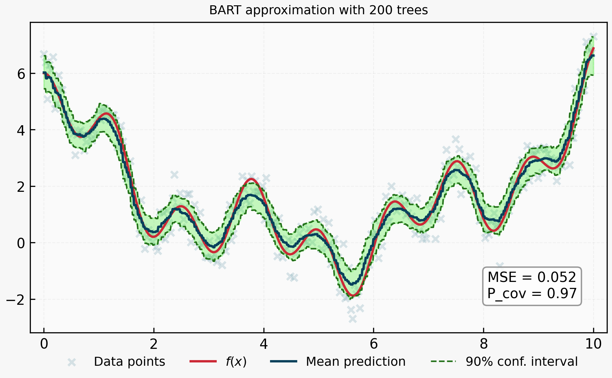
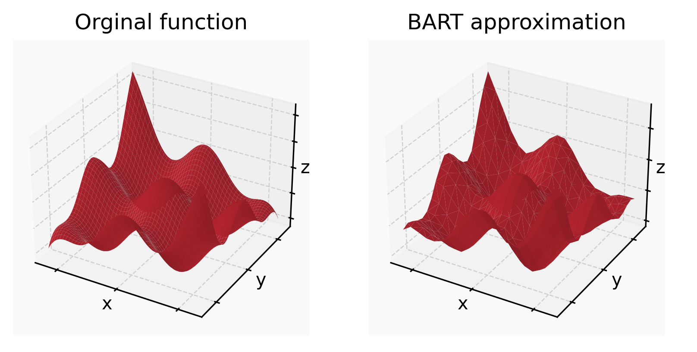

# GenBART

[](https://github.com/PetarMatejcic/GenBART/actions/workflows/tests.yml)

GenBART is a machine-learning library for **regression and binary classification**, built from scratch in Python and C++.

It implements **Bayesian Additive Regression Trees (BART)**, a flexible tree-based model that can learn nonlinear relationships and interactions while also providing uncertainty estimates for its predictions.

GenBART is designed both as a usable modeling package and as an implementation that makes the underlying BART algorithm easier to study and extend.

**Quick links:** &nbsp;
[Documentation](https://petarmatejcic.github.io/GenBART/) ·
[Getting Started](https://petarmatejcic.github.io/GenBART/getting_started.html) ·
[Python API](https://petarmatejcic.github.io/GenBART/api/python/index.html) ·
[Examples](notebooks/)

## Highlights

- Regression and probit classification
- Posterior prediction and uncertainty summaries
- Variable importance, feature selection, and partial dependence
- Python interface with a custom C++ sampling backend

## Preview

<p align="center">
  
</p>
<p align="center">
  
</p>

<p align="center">
  <em>Examples of nonlinear functions learned by GenBART.</em>
</p>


## What is BART?

**Bayesian Additive Regression Trees (BART)** is an ensemble method that represents the response as the sum of many small regression trees.

Each tree contributes a limited component of the fitted function, while the ensemble captures nonlinear effects and interactions between predictors.

BART places prior distributions on the tree structures and terminal-node parameters and estimates the model using Markov chain Monte Carlo (MCMC). The resulting posterior samples can be used for point prediction, uncertainty quantification, partial dependence, and variable-importance summaries.


## Project scope

GenBART was developed from scratch to provide a compact implementation of both the statistical model and its computational machinery.

The package combines a Python interface with a C++ implementation of the tree-update and backfitting routines. It also includes posterior prediction, interpretation utilities, variable selection, and model-selection tools.

A separate research component of the project investigates a **log marginal-likelihood-weighted variable importance measure**, which extends standard BART variable inclusion proportions by incorporating information about the contribution of individual tree splits.

## Installation

Clone the repository and install GenBART from the project root:

```bash
git clone https://github.com/PetarMatejcic/GenBART.git
cd GenBART
python3 -m pip install .
```

GenBART includes a compiled C++ backend, so installation requires a working C++ build toolchain in addition to Python 3.10 or later.

For development, install the package in editable mode with the development dependencies:

```bash
python3 -m pip install -e ".[dev]"
```


## Quick start

A regression model can be fitted and used for prediction with a small estimator-style interface:

```python
import numpy as np
from genbart import RegBart

rng = np.random.default_rng(0)

X = rng.uniform(0, 1, size=(200, 2))
y = (
    np.sin(2 * np.pi * X[:, 0])
    + X[:, 1] ** 2
    + rng.normal(0, 0.1, size=200)
)

model = RegBart(
    m=200,
    n_burn=200,
    n_samples=1000,
    random_state=0,
)

model.fit(X, y)

pred = model.predict(X[:5])

print(pred["prediction"])
print(pred["conf_int_low"])
print(pred["conf_int_high"])
```

`RegBart` returns posterior point estimates together with credible intervals for the fitted regression function.

For binary outcomes, GenBART provides the corresponding `ProbitBart` estimator.

## Variable importance and feature selection

GenBART provides two BART-based variable-importance measures.

Standard **variable inclusion proportions** measure how frequently each predictor is used in posterior tree splitting rules:

```python
raw_importance = model.variable_inclusion(kind="raw")
```

GenBART also implements a **log marginal-likelihood-weighted** importance measure, which weights split occurrences by their estimated contribution to the surrounding tree structure:

```python
logml_importance = model.variable_inclusion(kind="logml")
```

Variable importance provides a ranking or relative measure of predictor relevance. When an explicit selected feature set is required, GenBART provides permutation-null feature selection through `BartVariableSelector`:

```python
from genbart import BartVariableSelector, RegBart

selector = BartVariableSelector(
    model_cls=RegBart,
    model_params={
        "m": 20,
        "n_burn": 200,
        "n_samples": 500,
    },
    n_permutations=20,
    n_repeats=3,
    method="global_se",
    importance_kind="logml",
    random_state=0,
)

result = selector.fit(X, y)

print(result.selected_features())
```

The selector supports both standard and logML-weighted importance, together with local, global-max, and global-SE permutation thresholds.

For methodological details and the complete selection API, see the [feature-selection documentation](https://petarmatejcic.github.io/GenBART/api/python/feature_selection/index.html).


## Implementation overview

GenBART separates the user-facing statistical interface from the computational routines used during BART sampling and prediction.

- The **Python layer** provides the regression and classification estimators, input validation, posterior summaries, interpretation tools, feature selection, and model selection.
- The **C++ backend** implements tree operations, MCMC tree proposals, Bayesian backfitting, and posterior forest prediction.

The C++ backend is exposed to Python through `pybind11`, allowing the package to retain a Python-level modeling interface while executing repeated tree operations in compiled code.


## Examples

Example notebooks are available in the [`notebooks/`](notebooks/) directory:

- [Regression example](notebooks/basic_regression_example.ipynb)
- [Probit classification example](notebooks/basic_probit_example.ipynb)

Additional usage guidance is available in the [Getting Started](https://petarmatejcic.github.io/GenBART/getting_started.html) and [User Guide](https://petarmatejcic.github.io/GenBART/user_guide/index.html).

## Project status

Regression BART, probit BART, posterior prediction, interpretation utilities, permutation-based feature selection, and basic model-selection tools are implemented and covered by automated tests.

The project remains under active development, and the public API may change before a stable `1.0` release.

## Reference

The implementation is based on the BART model introduced in:

> Chipman, H. A., George, E. I., and McCulloch, R. E. (2010).  
> **BART: Bayesian Additive Regression Trees.**  
> *The Annals of Applied Statistics*, 4(1), 266–298.  
> [https://doi.org/10.1214/09-AOAS285](https://doi.org/10.1214/09-AOAS285)


## License

GenBART is released under the [MIT License](LICENSE).
